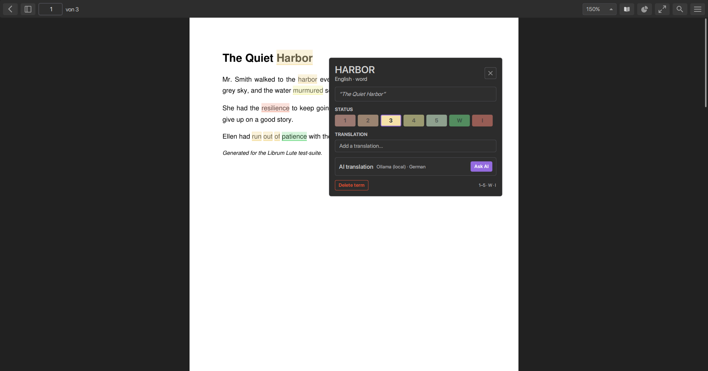
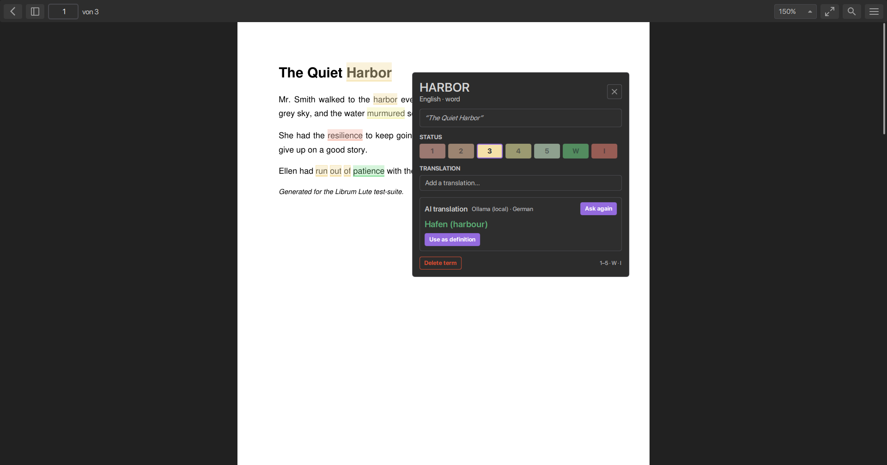
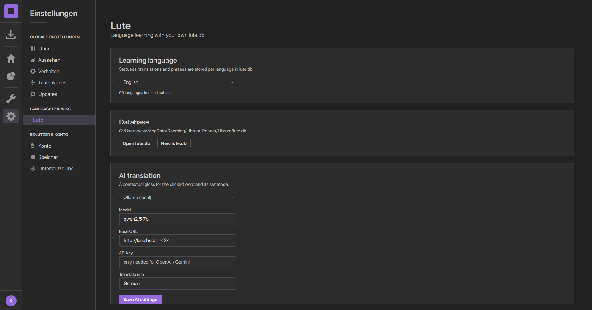

# Librum + Lute

This is a fork of [Librum Reader](https://github.com/Librum-Reader/Librum) that
brings [Lute v3](https://github.com/LuteOrg/lute-v3)'s language-learning
mechanics into Librum's own interface. Nothing about Librum's look was
reimplemented: the reading page, the popups, the settings and the statistics
page are Librum's own QML, and the Lute features were added on top of it.



## What was added

* **Create and import texts** – "New text" pastes a text into a new Lute book,
  "Import .txt" reads a text file, "Add a PDF" converts a PDF into a Lute book.
  Imported texts are paginated with Lute's rules (about 250 tokens per page,
  optional sentence splitting, `---` starts a new page) and become readable in
  the Lute reader.
* **Lute library and text reader** – the sidebar entry *Lute* (Ctrl+6) opens
  the books of the selected language from the real `lute.db` (the user's own
  library and progress), and opens them in a Lute text reader: pages as rich
  text, every word clickable, coloured by its status, with prev/next, page
  indicator and "mark page read".
* **Lute word popup** – a single left click on a word opens a popup with the word,
  its sentence, Lute's seven statuses (1–5, well-known, ignored), a translation
  field, an optional romanisation field and the AI gloss.
* **Coloured underlines on the page** – every word that has a Lute status is
  underlined in its status colour, drawn by `MLutePageOverlay` above Librum's
  `PageView`. Phrases that are stored in Lute are boxed.
* **Same `lute.db` as Lute v3** – the fork reads and writes the original schema
  (`words`, `languages`, `books`, `texts`, `wordparents`, `bookstats`,
  `wordsread`, `_migrations`). A new database is created from the shipped Lute
  template on first start (69 languages), and an existing `lute.db` can be
  opened in *Settings → Lute*.
* **Word extraction through MuPDF** – `LuteWordExtractor` uses the engine
  Librum renders with, so every word box lines up with the rendered page. It
  also builds the sentence context with Lute's own sentence-splitting rules.
* **Phrase support** – drag over several words to open the Lute popup for that
  phrase; choosing a status stores it as a multi-word term. Stored phrases are
  matched per page and highlighted (and boxed) as one block.
* **Verified AI** – the Ollama path is exercised against a mock server by
  `--lute-demo-ai` (the popup shows the returned gloss with "Use as
  definition"). OpenAI and Gemini use the same request/parse pipeline.
* **AI translation** – Ollama (local), OpenAI and Gemini, with the provider,
  model, base URL and API key configured in *Settings → Lute*. The AI gets the
  word and its sentence as context.
* **Statistics page** – Librum's placeholder page now shows the Lute vocabulary
  of the selected language: terms, learning/known counts, words read, the
  coverage of the currently open document and the status distribution.
* **Single-click word selection** – Librum only selected a word on double
  clicks; the fork selects it on a normal click (a small change in
  `PageView::mouseReleaseEvent`) so looking a word up feels like Lute.
* **Offline reading** – Librum normally requires an account. The fork adds an
  *Open a PDF without an account* button to the login page and can be started
  with a file path (`librum.exe book.pdf`, "Open with Librum"). Settings are
  seeded from the shipped defaults in this mode.

| Phrase popup | AI gloss | Settings → Lute | Statistics |
| --- | --- | --- | --- |
|  |  |  |  |

## Building

Requirements: Qt 6.8 (MSVC 2022 64-bit), Visual Studio 2022 with the C++
workload, CMake ≥ 3.24, Ninja, Python 3 with `libclang`, and the git
submodules.

```powershell
git submodule update --init --recursive --depth 1
python -m pip install libclang

cmake -S . -B build -G Ninja `
      -DCMAKE_BUILD_TYPE=Release `
      -DBUILD_TESTS=Off `
      -DNO_VENV=ON `
      -DCMAKE_PREFIX_PATH=C:/Qt/6.8.3/msvc2022_64
cmake --build build --parallel
```

The result is `build/librum.exe` next to the Qt and MuPDF DLLs.

Notes on the Windows build in this fork:

* MuPDF is built by `scripts/mupdfwrap.py`. The checked-in solution targets the
  VS2019 toolset, so the CMake command passes `--vs-upgrade 1`; MuPDF then lands
  in `libs/mupdf/platform/win32-vs-upgrade/x64/Release/`.
* The MuPDF C++ wrapper DLL does not export the C API, so the Lute slice links
  the static MuPDF libraries (`libmupdf`, `libthirdparty`, …) that the same
  build produces. Because of that, use a Release build; a Debug build would mix
  C runtimes.
* `-DLIBRUM_CONSOLE=ON` keeps a console window with the QML messages, which is
  useful while developing.
* The QML files are compiled into a `.qrc`; the fork adds explicit
  `OBJECT_DEPENDS` entries for them because CMake's AUTORCC otherwise kept
  stale QML in the binary after edits.

## Running

* `librum.exe` – start page; use *Open a PDF without an account* to read.
* `librum.exe --lute-db C:\path\lute.db` – use a specific Lute database.
* `librum.exe C:\path\book.pdf` – opens the reader directly.
* The Lute database defaults to
  `%APPDATA%\Librum-Reader\Librum\lute.db`. Change it in *Settings → Lute*
  or with `--lute-db`. The learning language is matched by name, so a database
  containing only e.g. Polish selects Polish instead of failing.
* *Settings → Lute* also selects the learning language, configures the AI and
  adds PDFs to the Lute library ("Add a PDF…" works without an open document;
  the result is shown in a banner).
* The word popup supports `1`–`5`, `W` (well-known), `I` (ignored) and `Esc`.

### QA helpers

```powershell
librum.exe --lute-selftest book.pdf          # extract words, print, exit
librum.exe book.pdf --lute-demo --out r.png   # seed statuses, open popup, screenshot
librum.exe book.pdf --lute-demo-click --out c.png  # click a word through the real event path
librum.exe book.pdf --lute-demo-phrase --out p.png # drag over "run out of", store it as a phrase
librum.exe --lute-db lute.db --lute-demo-hub --out lib.png     # Lute book library
librum.exe --lute-db lute.db --lute-demo-reading --out read.png # open the first book
librum.exe --lute-db lute.db --lute-demo-word --out word.png   # reader + word popup
librum.exe --lute-db lute.db --lute-demo-create --out new.png  # create a book from text
python scripts/mock_ollama.py                      # tiny Ollama stand-in on :11888
librum.exe book.pdf --lute-demo-ai --out a.png     # AI gloss via the mock server
librum.exe book.pdf --lute-demo-settings --out s.png
librum.exe book.pdf --lute-demo-stats --out t.png
librum.exe --lute-demo-login --out l.png
```

## Tests

```powershell
cmake -S . -B build-tests -G Ninja -DCMAKE_BUILD_TYPE=Release -DBUILD_TESTS=ON `
      -DNO_VENV=ON -DCMAKE_PREFIX_PATH=C:/Qt/6.8.3/msvc2022_64
cmake --build build-tests --target lute_unit_tests
ctest --test-dir build-tests -R LuteUnitTests --output-on-failure
```

`tests/lute_unit_tests` covers the tokenizer/sentence splitter, the database
round trip (template creation, terms, phrases, reading statistics, books/texts)
and the phrase matcher (16 gtest cases).

## Known limitations

* The Librum server features (account, cloud library, book downloads, sync) are
  untouched and still need a Librum server; this fork focuses on reading local
  PDFs.
* A drag selection opens the Lute phrase popup instead of Librum's selection
  options, so Librum's copy/highlight entries are only reachable through its
  own shortcuts while Lute is active.
* Pages with a `/Rotate` entry are extracted in unrotated page space.
* Translations/statuses are stored per language exactly like Lute; switching the
  language in *Settings → Lute* switches the vocabulary.
* The AI request is a direct HTTP call from the application, like Lute's own
  AI integration.

## Licensing

Librum is GPL-3.0, Lute is MIT, MuPDF is AGPL-3.0. This fork keeps Librum's
GPL-3.0 licensing and includes Lute's MIT-licensed database schema/data as part
of the combined work. See `LICENSE` and the upstream projects for details.
