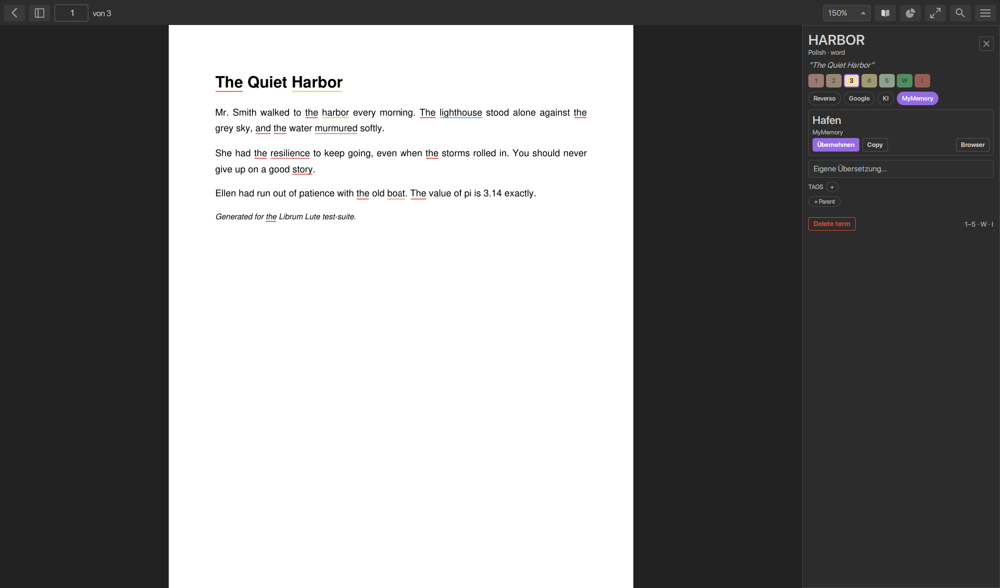
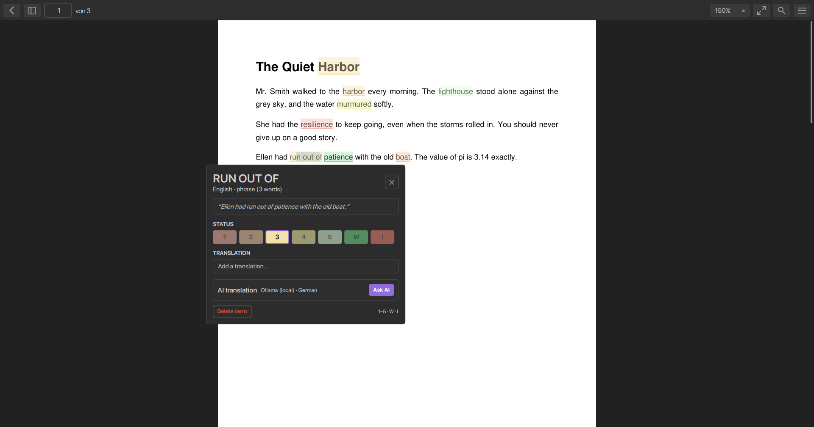
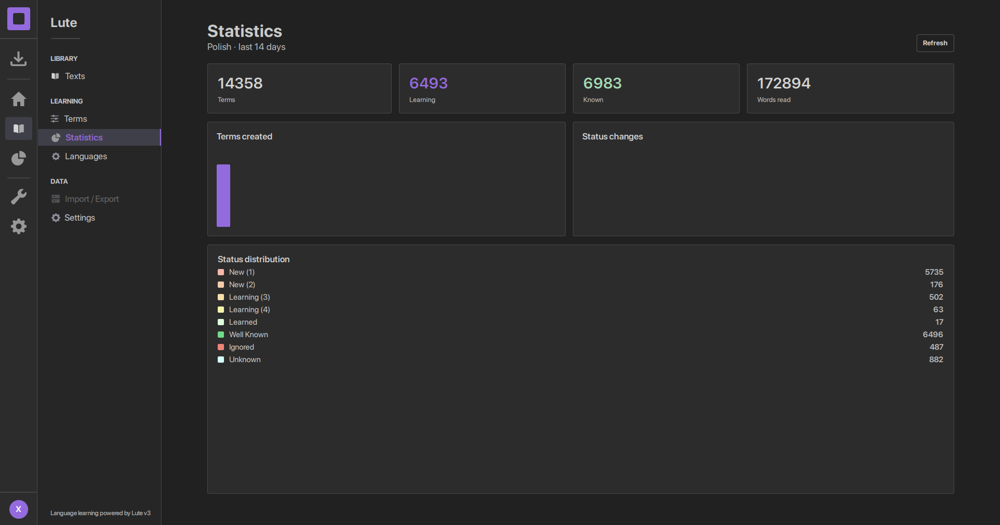

# LibrumLute

**Librum, the free ebook reader — fused with [Lute v3](https://github.com/LuteOrg/lute-v3), the language-learning workflow.**

Click any word while reading and get a term panel with four switchable translation
sources — Reverso Context, Google Translate, AI (Gemini / OpenAI-compatible / Ollama)
and MyMemory — plus the full Lute pipeline: word statuses, phrase terms, spaced
repetition stats and a real `lute.db`.

<p>
  
  
</p>
<p>
  
</p>

## Why this fork

Librum has the better reading experience; Lute v3 has the better
language-learning workflow. LibrumLute is Librum's interface with Lute's engine
bolted in — one window, no tab switching, one `lute.db`:

* **Term panel instead of dictionary iframes** — every word click opens a compact
  editor: sentence context, status chips (1–5 / W / I), romanization, tags and
  parents, and the translation area with four sources you can switch per word.
  The chosen status is underlined on the page as you read.
* **Four translation sources, one click apart** — Reverso Context (best-effort
  scrape with real example pairs, browser-link fallback), Google Translate,
  **AI gloss** (Google Gemini, any OpenAI-compatible endpoint, or local Ollama)
  and MyMemory (keyless). Enabled sources are configurable; the active source is
  remembered per app.
* **Real Lute v3 compatibility** — genuine `lute.db` schema, 66 shipped languages
  with parsers, terms/phrases/tags/parents, text archive and statistics. Point it
  at an existing Lute database and keep working.
* **Every input format Librum reads** — EPUB (with word highlighting in the page
  view), PDF, MOBI, AZAZ, FB2, CBZ, plain text — online or fully offline.
* **Phrase learning** — select several words to store a phrase term; it is later
  highlighted as a block with its own status and stats.
* **Lute statistics inside the reader** — learning status distribution and daily
  activity from the same database.

## Translation sources & privacy

| Source | Needs a key? | What is sent |
|---|---|---|
| Reverso Context | no | the word |
| Google Translate | no | the word |
| AI (Gemini/OpenAI/Ollama) | Gemini/OpenAI: yes | the word **and its sentence** |
| MyMemory | no | the word |

The sentence goes **only** to the AI backend you configure — never to Google,
MyMemory or Reverso. The AI target language is a dropdown of all 66 supported
languages; results are cached per word, source and language.

AI settings (provider, model, base URL, key, target language) live in
**Settings → Lute → AI translation**. A config saved with another provider's
defaults self-heals on load, and AI errors name the provider and URL actually
used.

## Download & run

Windows x64 (the platform this fork is built and tested on):

1. Build the portable package (see *Building*), or grab a release if one exists.
2. Run `LibrumLute.exe` — no account, no install. "Open a PDF without an account"
   works out of the box; EPUBs can be opened directly or from the library.
3. Open a word to see the term panel; **Settings → Lute** configures the database,
   translation sources and AI.

The Lute database lives at `%APPDATA%\Librum-Reader\Librum\lute.db` and is a plain
Lute v3 SQLite file.

## Building (Windows)

Prerequisites: **Qt 6.8.x (msvc2022_64)**, Visual Studio 2022 (C++ workload),
CMake 3.28+, Python 3 (MuPDF build).

```bat
git clone --recurse-submodules https://github.com/NotXave/LibrumLute.git
cd LibrumLute
cmake -B build-package -DCMAKE_BUILD_TYPE=Release
cmake --build build-package --parallel
```

Convenience wrappers (used during development, paths are machine-specific):

* `build-package\bp.bat` — release build
* `build-package\deploy.bat` — assemble `dist\LibrumLute-0.1.0-win64\` (portable)
* `build-tests\bt.bat lute_unit_tests` / `at.bat` — build test suites
* `build-tests\rt.bat` — run the 54 Lute unit tests; `at.bat` — the 106
  application tests

## Building (Linux)

Prerequisites: **Qt 6.8.x** (e.g. via the [online installer](https://www.qt.io/download-open-source)
or `aqtinstall`), GCC 12+ or Clang 16+, CMake 3.21+, Ninja, Python 3 with pip
(`pip install libclang` — the MuPDF wrapper generator needs it), and
`libjpeg-dev` (MuPDF builds against the system libjpeg to match Qt).

```bash
git clone --recurse-submodules https://github.com/NotXave/LibrumLute.git
cd LibrumLute
sudo apt-get install -y ninja-build libjpeg-dev libgl1-mesa-dev  # Ubuntu/Debian
cmake -B build -GNinja -DCMAKE_BUILD_TYPE=Release -DNO_VENV=ON \
      -DCMAKE_PREFIX_PATH=/path/to/Qt/6.8.3/gcc_64
cmake --build build
```

Run from the build directory: `./build/librum` (Qt libs must be on the
library path, e.g. `source /path/to/Qt/6.8.3/gcc_64/bin/qt-env.sh` or set
`LD_LIBRARY_PATH`). The Lute database lives at
`~/.local/share/Librum-Reader/Librum/lute.db`.

Install system-wide with the upstream install rules:

```bash
sudo cmake --install build        # /usr/local by default
```

The auto-updater is Windows-only; on Linux the update page falls back to a
"download manually" dialog.

## Tests

```bash
cmake -B build-tests -DBUILD_TESTS=ON -DNO_VENV=ON -DCMAKE_PREFIX_PATH=...
cmake --build build-tests
ctest --test-dir build-tests --output-on-failure
```

Four suites run: Adapter (81), Domain (48), Application (106) and Lute (54)
unit tests. CI (`.github/workflows/test.yml`) runs the same suites on
`ubuntu-latest` and `windows-latest` with Qt 6.8.3 on every push/PR to `main`.

## Documentation

* [`LUTE.md`](LUTE.md) — the full feature/architecture write-up of the fork
* [`docs/LUTE_GOAL.md`](docs/LUTE_GOAL.md) — the phase-by-phase fusion log
* [`docs/lute/`](docs/lute/) — screenshot collection

## Credits & license

LibrumLute is a fork of [Librum](https://github.com/Librum-Reader/Librum)
(GPL-3.0, © Librum-Reader contributors) and integrates the engine and schema of
[Lute v3](https://github.com/LuteOrg/lute-v3) (MIT, © Jeff Zohrab / LuteOrg).
See [LICENSE.md](LICENSE.md) (GPL-3.0) for the fork's license; third-party
components (MuPDF, PDFium, Inter) keep their own licenses as shipped by
upstream Librum.

Not affiliated with the Librum or Lute projects. If you want the polished
upstream experience — cloud library, cross-device sync — use
[Librum](https://librumreader.com); if you want the classic Lute web app, use
[Lute v3](https://github.com/LuteOrg/lute-v3). LibrumLute is for the specific
combination of both.
